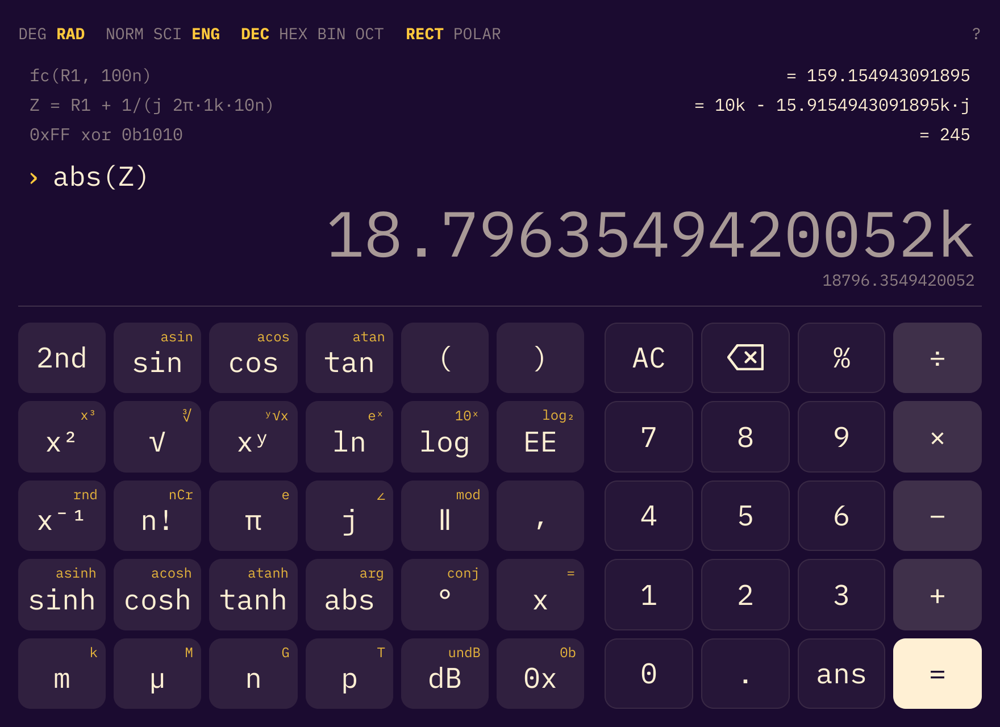

# Omacalc

An engineering calculator built with Qt Quick and C++ that automatically follows the Omarchy theme and system dark/light mode.

This is an engineering edition of [omacom-io/omacalc](https://github.com/omacom-io/omacalc),
the dead-simple calculator that ships with Omarchy. It keeps the look and the
theme integration and adds a full expression engine.




## Install

Build from source (the `omacalc` package in the Omarchy repository installs the
original, simple calculator):

```sh
sudo pacman -S --needed base-devel qt6-base qt6-declarative
git clone https://github.com/yaghofgm/omacalc-engineering
cd omacalc-engineering
bin/build            # produces build/omacalc
bin/test             # optional: runs the test suite
```

To make it the calculator your launcher and Omarchy's calculator keys open,
install it into `/usr/local/bin`, which comes before `/usr/bin` on the path:

```sh
sudo install -Dm755 build/omacalc /usr/local/bin/omacalc
```

This leaves the packaged `/usr/bin/omacalc` alone; remove
`/usr/local/bin/omacalc` to go back to it. Rebuild and re-run the install line
to update.

## Usage

Omacalc is an engineering calculator: type an expression, watch the result
preview as you type, and press `Enter` to commit it to the history. The
keypad covers the same ground for the mouse, with a `2nd` key for the
alternate functions shown in each key's corner.

- **Arithmetic** with real precedence, parentheses (left open ones close
  themselves), `^` or `**` for powers, and implicit multiplication that binds
  tighter than `×`/`÷`: `2πf`, `3(4 + 5)`, `1/2π` = 1/(2π).
- **SI prefixes** on numbers: `4.7k`, `10u`/`10µ`, `100n`, `5p`, `1M`, `3G`.
  The ENG display mode shows results the same way, so they paste back in.
- **Parallel** combinations: `10k ∥ 4.7k` (or `||`, or `par(a, b, …)`).
- **Complex numbers** for impedances and phasors: `3 + 4j`, `1/(j 2π·1k·1µ)`,
  polar entry `5∠53.13` (type `@` for `∠`), and RECT/POLAR display.
- **Trig** in DEG or RAD, with `30°` always meaning degrees; inverse and
  hyperbolic functions; exact results at the usual angles (`sin(180°)` is 0).
- **Logs, roots and friends**: `ln`, `log`, `log(x, b)`, `log2`, `√`, `∛`,
  `root(x, n)`, `exp`, `n!`, `nCr`, `nPr`, `gamma`, `gcd`, `lcm`, rounding,
  and `db`/`dbp`/`undb`/`undbp` for decibels.
- **Statistics**: `sum`, `mean`, `median`, `stdev`, `var`, `min`, `max`, `hypot`.
- **Programmer**: `0xFF`, `0b1010`, `0o17` literals; `&`, `|`, `xor`, `~`, `<<`,
  `>>`; DEC/HEX/BIN/OCT display.
- **Constants**: `π`, `e`, `j`, `c`, `h`, `hbar`, `kB`, `q`, `ε0`/`eps0`,
  `μ0`/`mu0`, `Z0`, `VT`, `NA`, `R`, `g`, and more. Physical constants give way
  to your own variables, so `R = 10k` just works.
- **Variables and functions** that persist between sessions: `R1 = 10k`,
  `fc(r, c) = 1/(2π r c)`, then `fc(R1, 100n)`. `ans` is the last result, and
  starting a line with an operator continues from it.

Press `F1` (or click `?`) for the full reference of functions and constants.

Keyboard:

- `Enter` calculates, `Esc` clears, `↑`/`↓` walk the history.
- `Ctrl+C` copies the result (or the selection).
- `Ctrl+D` DEG/RAD, `Ctrl+E` NORM/SCI/ENG, `Ctrl+B` DEC/HEX/BIN/OCT,
  `Ctrl+P` RECT/POLAR, `Ctrl+L` clears the history, `Ctrl+Q` quits.
- Click a history expression to edit it, or its result to insert it. Select
  part of the input and press a function key to wrap it.

Colors follow the current Omarchy theme (`~/.local/state/omarchy/current/theme/colors.toml`)
and re-tint live when the theme changes. Text follows the desktop text size —
`omarchy display text size`, or GNOME's `text-scaling-factor`.

## Requirements

- Qt 6: `qt6-base`, `qt6-declarative`
- `xdg-desktop-portal` and a portal backend

The iA Writer Mono font is bundled under the SIL Open Font License 1.1; see
`fonts/OFL.txt`. The font is copyright Information Architects Inc. and based on
IBM Plex, copyright IBM Corp.
